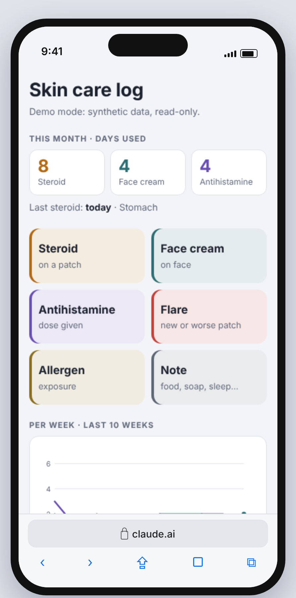
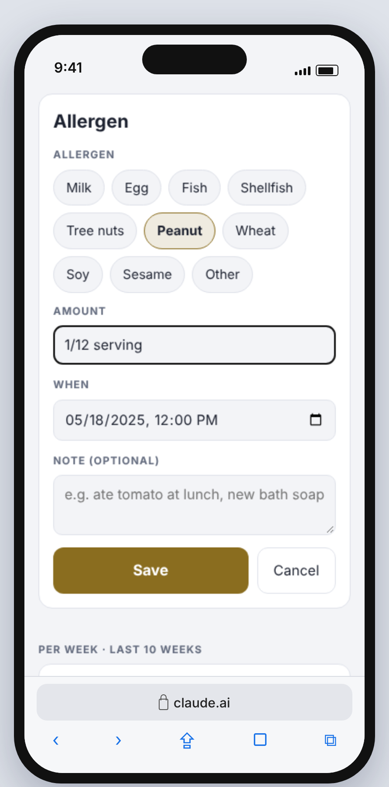
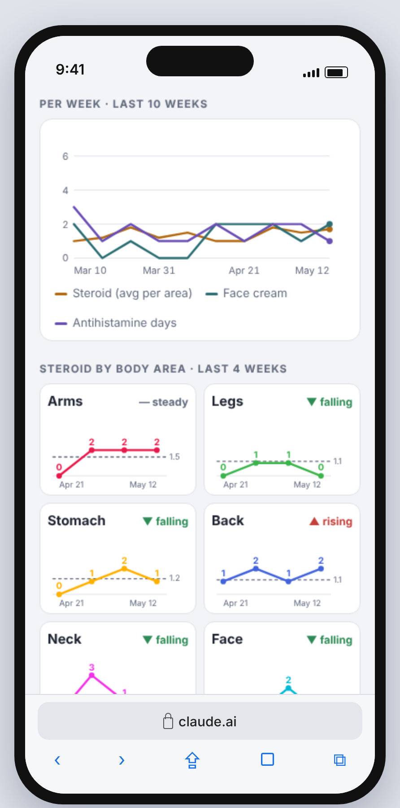
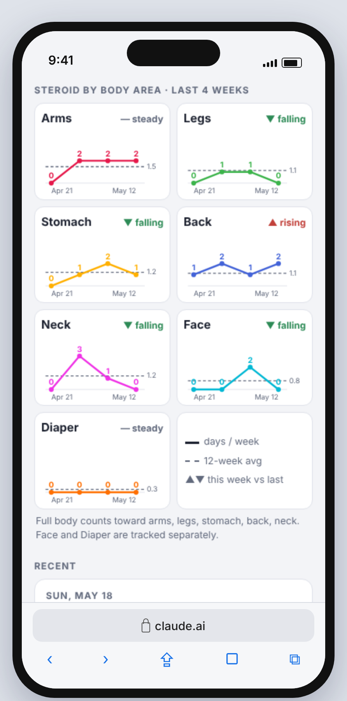
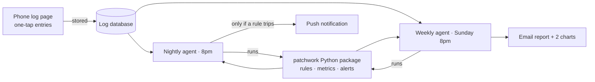
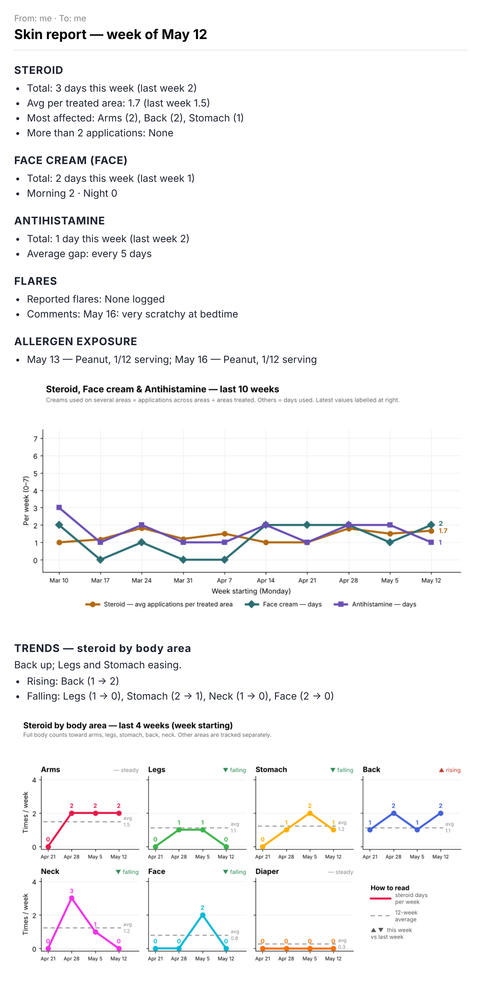

# Patchwork

**An AI agent that helps a worried parent — one with too much to juggle — feel a little more at ease about medical tracking.**

I am that parent: worried, underslept, striving to do right by my daughter and keep her health on track. She is an amazing toddler who has struggled with borderline severe eczema since she was 3 months old. After months of trying different ointments, medications, and approaches we finally found something that works — but it generated 5 spreadsheets, manual calculations, and a daily question: "When did we last put on the medication?"

Patchwork is a small, real system I run for my own family, built so any family can set it up in a few minutes. A parent logs skin treatments with one tap on a phone. Every night an agent checks the log against a set of medical guidelines and parent-set rules, and pushes an alert only when something needs attention.

When you need to know whether you can apply more medication because your child is in pain — you check the page with its clear visual tracker. When you need to know how bad the week was — you read an automatic email sent every Sunday with treatment trends, visual and ready to share with a doctor.

This repo is the production code, published with synthetic data. No real health data lives here.

<p align="center">
  
  
  
  
</p>

---

## The problem

Managing a toddler's moderate eczema means juggling several treatments: a daily cream, a steroid on active patches, an antihistamine on bad days. The questions that matter at a dermatologist visit are about *patterns*, and a parent's memory at 7pm is a poor database:

- How often is steroid going on, and on which areas?
- Is any one area getting more than allowed by the medication?
- Is the antihistamine creeping from occasional to daily?
- Is there a clear trigger for flares? 

Paper logs and notes apps capture *what happened* but never answer those questions. Generic trackers ask for too much input at the worst moment of the day.

## Who it's for

Parents who were placed in a difficult situation: keeping track of medications for their child, while trying to learn more about atopic dermatitis, find answers to common triggers, and stay on top of their doctor's recommendations on creams, food introductions, and flares.

One parent, mid-bedtime, holding a wriggling toddler. That user sets every constraint:

| Constraint | Design response |
|---|---|
| Hands full, attention split | Five big buttons; most entries are two taps |
| Every family's treatments differ | A first-use questionnaire builds the profile: areas, creams, limits, antihistamine, allergens |
| Bedtime routine, not a clinical diary | Creams are logged by **date**, or Morning / Night when that matters; no time picker |
| Wants answers, not dashboards | Silent unless a rule trips; one weekly email |
| Will show this to a doctor | Deterministic counts, documented definitions |


## How it works



**The core design choices**

  The LLM operates the system — it does not do the math.                                 
  When you're dealing with sensitive medical data and medications that require precise measurement, you cannot rely on the creativity of an LLM. The **profile** is the single source of truth: body areas, what "full body" covers, creams and their limits, the antihistamine, allergen tracking. `rules.json` is the default; the questionnaire writes your own to `private/profile.json`. The page, the Python package, and the tests all read it.

  It operates on structured data, with a deterministic Python script to track and store the data. Where the agent comes into play is transferring that precise data into insights for parents from the findings of the script, presenting those insights in plain language — and delivering them seamlessly by sending weekly emails with findings reports and daily checks against triggers.

- **Rules live in code, not in prompts.** Your doctor set those limits for a reason. The agent follows them exactly by following the script and its defined rules — it has no power to drift from those limits.
- **Quiet unless it matters.** Bedtime is already hard. You shouldn't have to check anything. The only notification you'll get is when a medication limit is approaching or a trend needs attention.
- **Your child's health history is not a dataset.** No real medical data ever enters this repo. A test fails the build if it finds a private link, an email address, or any term from a local denylist in a published file — keeping your child's health history where it belongs.

  See [DECISIONS.md](DECISIONS.md)     


## What the agent checks

All limits are the parent's own, set once during the first-use questionnaire based on your doctor's instructions. One setup — and the agent does the rest.

**Nightly push (only when something trips)**

- Antihistamine given more often than the parent's limit (e.g. more than once in 3 days)
- Any body area getting a medical ointment on more days than its per-area weekly limit, or a cream over its total weekly limit
- Meaningful trends: this week vs. the 3 weeks before (≥ 1.5 days/week change), with the week's notes and allergen exposures as context

**Weekly report (Emailed directly to your inbox with summary and visuals)**

<p align="center">
  <br>
  <em>The log page in a phone browser, and the Sunday report as it lands in the inbox.<br>All screenshots use a synthetic log for a fictional toddler.</em>
</p> 

- Each medicine: total days, Morning / Night split if used; for creams used on several areas, average applications per treated area, most-affected areas, any area over the limit
- Antihistamine: total days, average gap between doses
- Flares and notes; allergen exposures with amounts
- Trends: which areas are rising or falling, against each area's 12-week average
- Two charts: a 10-week overview, and the main cream by body area as small multiples


## First-use setup

Clone the repo and open it in Claude Code: if there's no profile yet, Claude walks you through [`SETUP.md`](SETUP.md) conversationally. No Claude? `python -m patchwork init` asks the same questions in the terminal.

1. **Body areas**, with follow-ups: left/right? which spots roll up into which area (elbows → Arms)?
2. **Full body**: which areas it covers; the rest are always tracked on their own
3. **Creams**: name, where it's used, date-only or Morning / Night, per-area and total weekly limits
4. **Antihistamine**: brand and how often is too often
5. **Allergen exposure**: on or off; buttons for the 9 major allergens plus your own
6. **Delivery**: email, timezone, report day

Both write `private/profile.json`, validated against the same rules. With the hosted log, the profile is also saved in the log's own database, where the page and the agents read it, so the page itself never needs rebuilding. Answers never enter the repo.

## One source of truth

| What | Lives in | Read by |
|---|---|---|
| Logic: metrics, alerts, report, charts, page | this repo | scheduled agents (clone + run), the live page (`web/index.html` as-is) |
| The family's setup | the log's `config/profile` document | the page at load, the agents each run |
| The entries | the log's `entries` collection | the page, the agents |

The agent prompts contain no rules — only "clone, export, run, deliver" — so they never drift from the code.

## Guardrails

- **No medical advice.** The agent reports what the log shows and says "worth raising with her doctor". It never suggests changing a medication or dose.
- **Escalation first.** Signs of an allergic reaction get an emergency instruction before anything else.
- **Privacy by design.** Real entries never enter the repo; `private/` is git-ignored, and a test fails the build if an email address, a private link, or any term from a local denylist appears in a published file.

## Run it

```bash
pip install -r requirements.txt
pytest -q

# Your profile (or skip: the default profile in rules.json is used)
python -m patchwork init

# Synthetic data for a fictional toddler, following the active profile
python -m patchwork sample --out data/sample_entries.json

# Weekly report: writes report.txt / report.html / two PNG charts to out/
python -m patchwork weekly --entries data/sample_entries.json --today 2025-05-18 --out out

# Nightly check: prints alerts as JSON (empty on a quiet night)
python -m patchwork nightly --entries data/sample_entries.json --today 2025-05-18

# The phone page in demo mode
python -m http.server 8000   # then open http://localhost:8000/web/
```

Changed the default profile? Run `python -m patchwork page --profile rules.json` to refresh `web/index.html`. A test fails if you forget.

## Repo map

| Path | What it is |
|---|---|
| `rules.json` | Default profile and schema reference: areas, full body, creams, limits, antihistamine, allergens |
| `SETUP.md` | First-use questionnaire, for Claude |
| `patchwork/setup.py` | The same questionnaire in the terminal (`init`) |
| `patchwork/rules.py` | Loads and validates a profile; maps logged areas to tracked areas |
| `patchwork/page.py` | Builds the log page with a profile baked in |
| `patchwork/metrics.py` | Weekly counts, per-area average, dose gaps, rolling averages |
| `patchwork/alerts.py` | Nightly checks |
| `patchwork/report.py` | Weekly report as text and email HTML |
| `patchwork/charts.py` | The two charts |
| `patchwork/synthetic.py` | Fictional log generator |
| `web/index.html` | The phone log page (runs as a Claude artifact; demo mode locally) |
| `prompts/` | The two scheduled-agent prompts |
| `CLAUDE.md` | The agent's persona and rules |
| `DECISIONS.md` | Why things are the way they are |

## Results

I have been personally using and tracking my daughter's stats for the last 10 weeks, and I can confidently say it has decreased my nightly routine stress by a lot. Instead of trying to calculate when the cream was last used, whether it's being used more than before, or whether to try the antihistamine instead — I open one page and make a choice in seconds, not the long and dreadful minutes of trying to remember ahead of time while dealing with a crying toddler.

No more anxiety about staying within doctor's guidelines. I can now clearly see that my daughter has dramatically improved and requires far less medical intervention than she did months ago.

This has been personally tested, updated, and continuously improved to make bedtime a little easier for any parent managing a child's medical routine.

## What's next

- Doctor-ready monthly PDF summary
- Second caregiver logging from their own phone
- Correlating flares with food introductions
