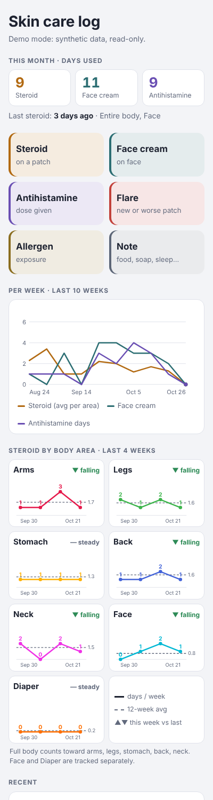
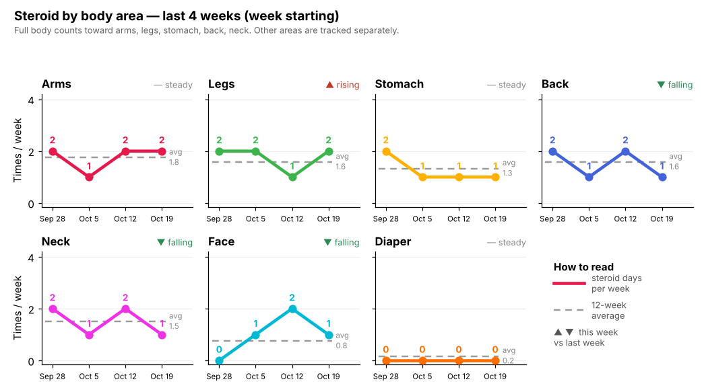
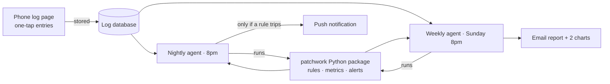

# Patchwork

**An AI agent that turns a parent's 5-second taps into eczema insights.**

Patchwork is a small, real system I run for my own family, built so any family can set it up in a few minutes. A parent logs skin treatments with one tap on a phone. Every night an agent checks the log against a few rules and pushes an alert only when something needs attention. Every Sunday it emails a one-screen report with two charts.

This repo is the production code, published with synthetic data. No real health data lives here.

<p align="center">
  
  
</p>

---

## The problem

Managing a toddler's moderate eczema means juggling several treatments: a daily cream, a steroid on active patches, an antihistamine on bad days. The questions that matter at a dermatologist visit are about *patterns*, and a parent's memory at 7pm is a poor database:

- How often is steroid going on, and on which areas?
- Is any one area getting more than the doctor's limit?
- Is the antihistamine creeping from occasional to daily?
- Do flares follow travel, illness, new foods?

Paper logs and notes apps capture *what happened* but never answer those questions. Generic trackers ask for too much input at the worst moment of the day.

## Who it's for

One parent, mid-bedtime, holding a wriggling toddler. That user sets every constraint:

| Constraint | Design response |
|---|---|
| Hands full, attention split | Five big buttons; most entries are two taps |
| Bedtime routine, not a clinical diary | Creams are logged by **date**, or Morning / Night when that matters; no time picker |
| Every family's treatments differ | A first-use questionnaire builds the profile: areas, creams, limits, antihistamine, allergens |
| Wants answers, not dashboards | Silent unless a rule trips; one weekly email |
| Will show this to a doctor | Deterministic counts, documented definitions |

<!-- YOU: one or two sentences in your own voice about why you built it. -->

## How it works



**The core design choice: the LLM operates the system; it does not do the math.**

- The **profile** is the single source of truth: body areas, what "full body" covers, creams and their limits, the antihistamine, allergen tracking. `rules.json` is the default; the questionnaire writes your own to `private/profile.json`. The page, the Python package and the tests all read it.
- `patchwork/` is plain, deterministic Python: same input, same report, every time. It is unit-tested.
- The agent (Claude, on a schedule) does only what code can't do well on its own: pull the latest entries, run the package, write one human sentence of summary, and deliver the result.

Why: a report a parent shows a doctor has to be *right* and *repeatable*. Early versions let the model count and draw charts itself; the numbers were usually right, but "usually" isn't good enough, and the charts drifted week to week. See [DECISIONS.md](DECISIONS.md).

## What the agent checks

All limits are the parent's own, set in the questionnaire from their doctor's instructions.

**Nightly (push only when something trips)**
- Antihistamine given more often than the parent's limit (e.g. more than once in 3 days)
- Any body area getting a cream on more days than its per-area weekly limit, or a cream over its total weekly limit
- Meaningful trends: this week vs. the 3 weeks before (≥ 1.5 days/week change), with the week's notes and allergen exposures as context

**Weekly report**
- Each cream: total days, Morning / Night split if used; for creams used on several areas, average applications per treated area, most-affected areas, any area over the limit
- Antihistamine: total days, average gap between doses
- Flares and notes; allergen exposures with amounts
- Trends: which areas are rising or falling, against each area's 12-week average
- Two charts: a 10-week overview, and the main cream by body area as small multiples

## First-use setup

Clone the repo and open it in Claude Code: if there's no profile yet, Claude walks you through [`SETUP.md`](SETUP.md) conversationally. No Claude? `python -m patchwork init` asks the same questions in the terminal.

1. **Body areas**, with follow-ups: left/right? which spots roll up into which area (elbows → Arms)?
2. **Full body**: which areas it covers; the rest are always tracked on their own
3. **Creams**: name, where it's used, date-only or Morning / Night, per-area and total weekly limits
4. **Antihistamine**: brand and how often is too often
5. **Allergen exposure**: on or off; buttons for the 9 major allergens plus your own
6. **Delivery**: email, timezone, report day

Both write `private/profile.json`, validated against the same rules. With the hosted log, the profile is also saved in the log's own database, where the page and the agents read it, so the page itself never needs rebuilding. Answers never enter the repo.

## One source of truth

| What | Lives in | Read by |
|---|---|---|
| Logic: metrics, alerts, report, charts, page | this repo | scheduled agents (clone + run), the live page (`web/index.html` as-is) |
| The family's setup | the log's `config/profile` document | the page at load, the agents each run |
| The entries | the log's `entries` collection | the page, the agents |

The agent prompts contain no rules — only "clone, export, run, deliver" — so they never drift from the code.

## Guardrails

- **No medical advice.** The agent reports what the log shows and says "worth raising with her doctor". It never suggests changing a medication or dose.
- **Escalation first.** Signs of an allergic reaction get an emergency instruction before anything else.
- **Privacy by design.** Real entries never enter the repo; `private/` is git-ignored, and a test fails the build if an email address, a private link, or any term from a local denylist appears in a published file.

## Run it

```bash
pip install -r requirements.txt
pytest -q

# Your profile (or skip: the default profile in rules.json is used)
python -m patchwork init

# Synthetic data for a fictional toddler, following the active profile
python -m patchwork sample --out data/sample_entries.json

# Weekly report: writes report.txt / report.html / two PNG charts to out/
python -m patchwork weekly --entries data/sample_entries.json --today 2026-10-25 --out out

# Nightly check: prints alerts as JSON (empty on a quiet night)
python -m patchwork nightly --entries data/sample_entries.json --today 2026-10-25

# The phone page in demo mode
python -m http.server 8000   # then open http://localhost:8000/web/
```

Changed the default profile? Run `python -m patchwork page --profile rules.json` to refresh `web/index.html`. A test fails if you forget.

## Repo map

| Path | What it is |
|---|---|
| `rules.json` | Default profile and schema reference: areas, full body, creams, limits, antihistamine, allergens |
| `SETUP.md` | First-use questionnaire, for Claude |
| `patchwork/setup.py` | The same questionnaire in the terminal (`init`) |
| `patchwork/rules.py` | Loads and validates a profile; maps logged areas to tracked areas |
| `patchwork/page.py` | Builds the log page with a profile baked in |
| `patchwork/metrics.py` | Weekly counts, per-area average, dose gaps, rolling averages |
| `patchwork/alerts.py` | Nightly checks |
| `patchwork/report.py` | Weekly report as text and email HTML |
| `patchwork/charts.py` | The two charts |
| `patchwork/synthetic.py` | Fictional log generator |
| `web/index.html` | The phone log page (runs as a Claude artifact; demo mode locally) |
| `prompts/` | The two scheduled-agent prompts |
| `CLAUDE.md` | The agent's persona and rules |
| `DECISIONS.md` | Why things are the way they are |

## Results

<!-- YOU: fill this in from real use, without health specifics. Ideas:
- weeks in use, entries logged, average seconds per entry
- alerts fired vs. alerts that were useful
- one pattern the report surfaced that changed a conversation with the doctor
-->

## What's next

- Doctor-ready monthly PDF summary
- Second caregiver logging from their own phone
- Correlating flares with food introductions
